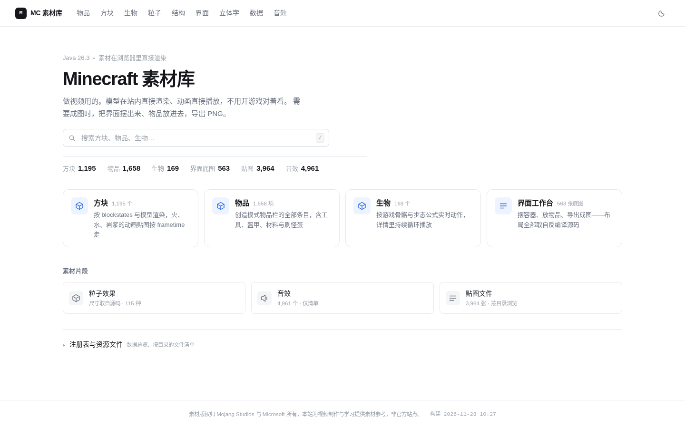
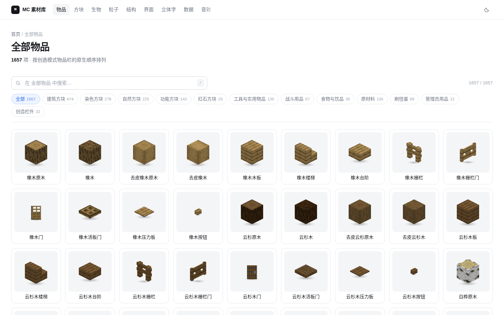
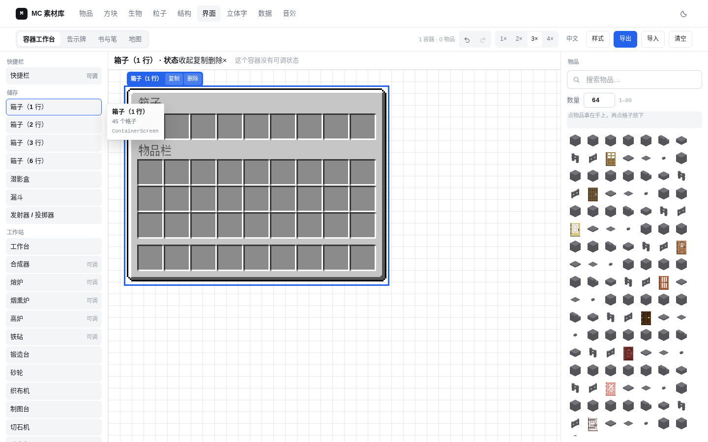
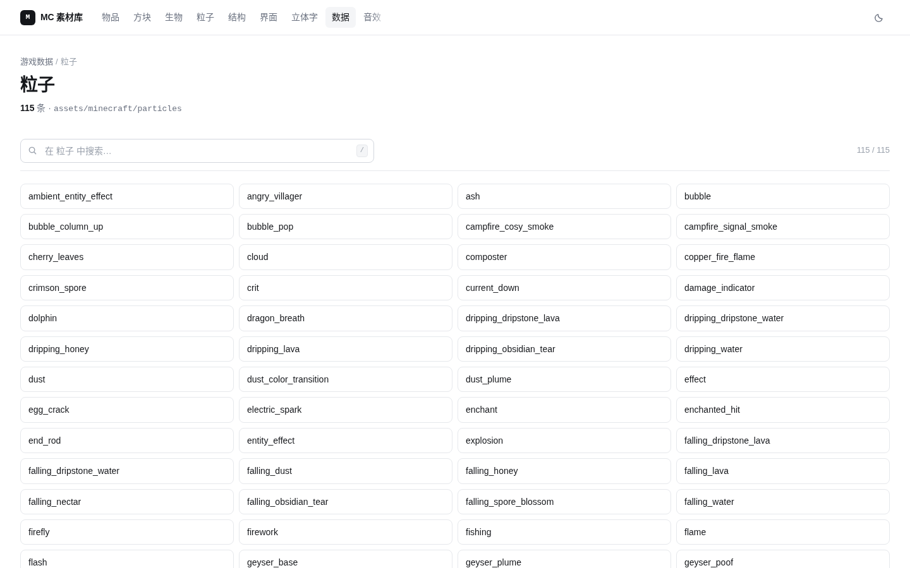
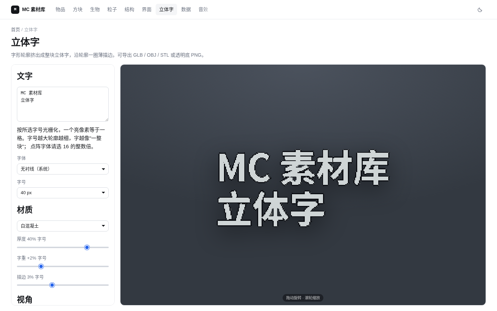
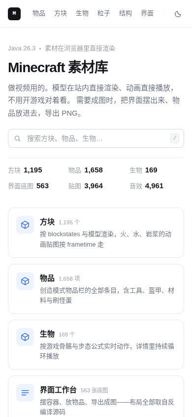
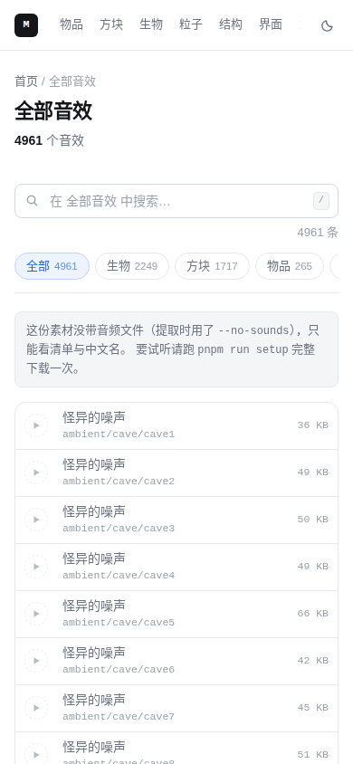

# 这次改了什么

一句话：**一套设计语言、一层可复用控件、一页一目录，顺手把本地与线上不一致的那批 bug 修掉。**



## 1. 结构：页面按功能切，样式按层收

```
src/
├── features/   一个目录 = 一个页面（页面 .tsx + 它自己的 .css）
├── ui/         设计系统：Page / Toolbar / SearchField / FilterChips /
│               AssetGrid / AssetTile / Dialog / Button / Switch
├── styles/     tokens → base → layout → ui → studio → workbench → legacy
├── components/ 跨页渲染组件（ModelView / ModelModal / 各面板）
├── lib/        数据、几何、动画、导出
└── render/     WebGL2 管线与 CPU 光栅化
```

- 旧的 13 个 `src/pages/*` 与 3900 行 `library.css` 已删除，剩余画布几何收进
  `styles/legacy-workbench.css`，并在文件头标注「迁移中，勿新增规则」。
- 全站只有一个变量源 `styles/tokens.css`（浅/深两套），页面里不再出现写死的色值。
- 写新页面的对照表在 `README.md` 的「写新页面时照这个来」。

## 2. UI：控件只有一套

| 以前 | 现在 |
|---|---|
| 每页一套搜索框，`/` 与 Esc 行为各不同 | `SearchField`：`/` 聚焦、Esc 清空、带清空按钮 |
| 每页一套卡片（`.block-cell` / `.tex-cell` / `.particle-cell` / `.entry-card`） | `AssetTile`：缩略区 + 单行名称 + 可选副标题，高度固定 |
| 每页自己拼标题、面包屑、空态 | `PageHeader` / `EmptyState` / `LoadingState` / `ErrorState` |
| 三个弹窗各写遮罩、Esc、滚动锁、退场 | `Dialog`：portal、Esc、滚动锁（含滚动条补偿）、焦点圈定、170ms 退场 |
| 工具栏与分类挤在一行，搜索框被挤成 30px | `Toolbar`：搜索独占一行并设上限，分类折行 |

工作台顶栏把「页签」和「工具」合并成一行，手机上省掉整整一行（约 56px 画布高度）。

## 3. 修掉的 bug

清单与原因写在 `README.md` 的「这次重构修掉的问题」里，这里只列结论：

**只在本地出现、上线才暴露的一类**（`sync` 与 `pack` 走的归一化不一致）
- 物品分类本地只有「全部 / 未分类」，线上 12 个 → `sync` 也复制 `creativetabs.json` 并重跑分组。
- 音效页本地一片空白（`sounds.json` 是 `items: []`）→ `sync` 覆盖派生清单。
- 首页写「音效 0 个」而音效页列 4961 条 → 计数改读实际分发的清单，`sync`/`pack` 共用同一个函数。
- 首页折叠区链到 `/registries/…` 要靠客户端重定向 → 数据侧统一 `/data/…`。

**样式撞车**（统一基元层之后才现形）
- 工作台状态条与空状态块共用 `.state`，状态条被撑成 64px 内边距的居中块 → 改名 `.statebar`。
- `.notice` 是 `display:flex`，里面的行内 `<span class="mono">` 各成一列，手机上整段提示碎成竖排文字 → 改块级。
- 立体字页 `textarea` 被压成一条、纹理弹窗图片只有一个小点、粒子弹窗深色块缩在中间 → 分别来自「flex 子项被压缩」「旧规则覆盖新尺寸」，逐条修。

**交互与可访问性**
- 导出失败原来用 `window.alert`：会截断长报错、关掉就没了 → 面板内可关闭的提示条。
- 注册表详情从站外直接打开时「返回上一页」点了没反应（历史里没有上一页）→ 改成显式链接。
- 路由懒加载的骨架是一行灰字、部分页面用 `state__hint` 拼空态 → 统一到 `LoadingState` / `EmptyState`。
- 虚拟网格行高写死、过滤后视口停在旧位置 → 实测行高，筛选变化回到顶部。
- 粒子和部分效果没有中文名（游戏里 `/particle` 也只认 id），卡片上同一个字符串印两遍 → 名字与 id 相同时不画副标题。

## 4. 验证

- `npx tsc -b`、`npx vite build` 通过；样式总量 91.7KB → 72KB。
- Playwright 双端（1440×900 / 390×844）跑完 20 条路由：无 console 报错、无横向溢出、
  提示条无竖排异常；深色主题另测。
- 交互回归：首页搜索跳转、滚动后搜索归零、物品分类跳转、音效搜索、结构切换写 query、
  主题切换、弹窗 Esc 关闭、工作台加容器后状态条（37px 单行）、纹理弹窗（440×440）。

| | |
|---|---|
|  |  |
|  |  |
|  |  |

## 5. 怎么跑

```bash
pnpm install
pnpm run setup:lite     # 只下图片，约 130MB；完整素材（含音效）用 pnpm run setup
pnpm dev
```

`mc-assets/` 不入库，`mc-derived/` 入库；`sync` 会把派生数据归一化进素材目录，
所以本地看到的分组、音效清单、注册表路由与部署后完全一致。
